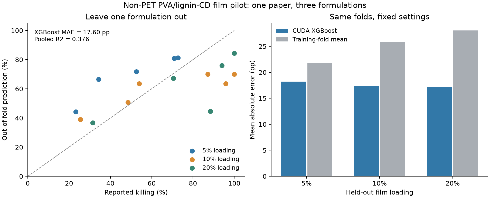

# 第一版传统模型训练报告

日期：2026-10-16。模型：固定参数 CUDA XGBoost。用途：非 PET 的 PVA/木质素碳点膜抗菌率流程基线。

实际训练设备：`cuda:0`。显卡信息：`0, NVIDIA GeForce RTX 4080 Laptop GPU, 617.14, 12282 MiB`。每个交叉验证折及全量拟合后均核查 Booster 配置，若回退 CPU 则训练失败。

## 结果

| 分组交叉验证指标 | CUDA XGBoost | 训练折均值基线 |
| --- | ---: | ---: |
| MAE（百分点） | 17.598 | 25.238 |
| RMSE（百分点） | 21.007 | 28.874 |
| 合并折外预测 R² | 0.376 | -0.179 |

XGBoost 的折外 MAE 低于均值基线。该结果只衡量本次小规模、同论文内的配方添加水平迁移，不能作为 PET 配方预测或跨论文泛化的证据。没有进行超参数搜索或从多组设置中挑选最好结果。

## 数据与标签

- 从 A08（DOI：10.1002/pen.70108）选择 16 条原文明确数值结果，共 3 个膜添加水平、1 个碳点合成样品、1 篇论文。
- 输入仅有：LCQD 添加百分数、抗菌接触时间、暗/可见光、菌种。文献 ID、配方 ID、原文页码及制备后表征均不作特征。
- 输出：相对论文指定对照的抗菌率（0–100）。原文存活率用 100−存活率作明确转换；同一观察已有的派生记录排除，避免重复计数。
- 不混合 MIC、抑菌圈、其他论文的测试协议、游离 CD、H2O2 辅助体系或金属复合结果。
- 按原库规则排除原文零存活且未给检出限的 1 条记录；仍保留原文报告 100% 抗菌率的 2 条边界记录，并进行敏感性分析。

## 验证方法

每次完整留出一个膜配方（5%、10% 或 20%），用其他两个配方训练。相同配方在不同菌种、光照和时间的记录不会跨训练和验证集。编码器也只在训练折拟合。没有独立外部测试集。

留出 5% 和 20% 时涉及训练加载水平之外的外推；留出 10% 是区间内插值。三折样本量很小，不能把合并 R² 解释成可靠的普适精度，也不报告无依据的显著性或置信区间。

剔除两个原文 100% 端点后，14 条记录的 XGBoost 折外 MAE 为 16.243 个百分点、R² 为 0.296。此结果用于检查边界值敏感性，不用于重新选择模型。

## 适用范围与不足

训练的是 PVA 膜中已有木质素碳点的添加和抗菌测试条件，不是 PET 合成配方。该论文 CD 的制备条件固定，因而本模型不能学习共前驱体、掺杂剂或合成温度/时间的作用。

原文添加 wt% 分母未明确，方法每 10 min 取样而正文结果使用 15/45 min，已在来源疑点中保留。训练按原文明确的添加水平和结果时间建模，不能把这些条件解释成已复现实验协议。

## 文件

- `training_data.csv`：实际进入模型的观察和原始测量 ID。
- `excluded_rows.csv`：原始 96 条记录中各被排除行及原因。
- `oof_predictions.csv`、`fold_metrics.csv`：逐行折外预测和分折误差。
- `metrics.json`：可机器读取的结果和输入文件哈希。
- `models/literature_pva_xgb_cuda_v1/model.joblib`、`booster.json`、`metadata.json`：全量 16 条记录拟合的管线、原生 XGBoost 模型与版本/用途信息。

全量拟合模型用于复现和受限试用；它不再有额外独立测试分数。预测入口会拒绝 PET、其他材料层级、未知菌种/光照及训练范围之外的输入。
